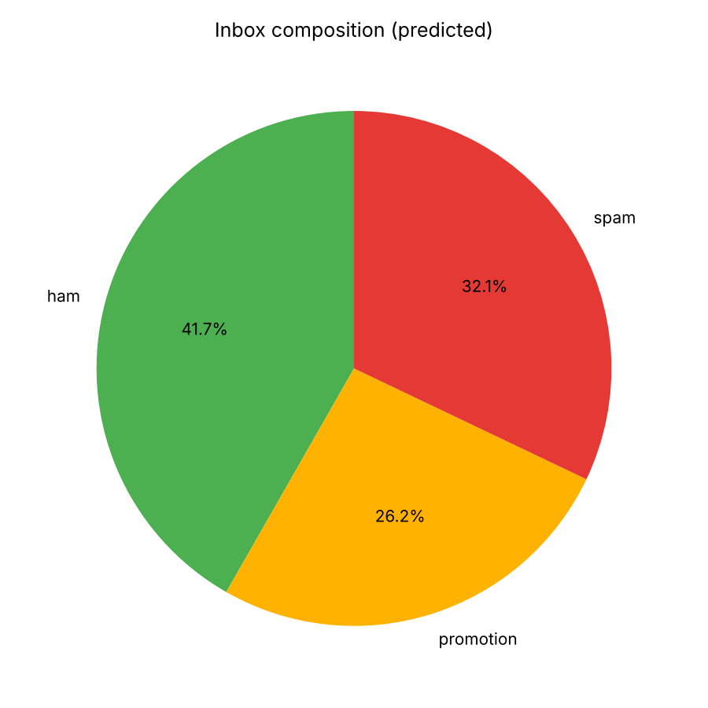
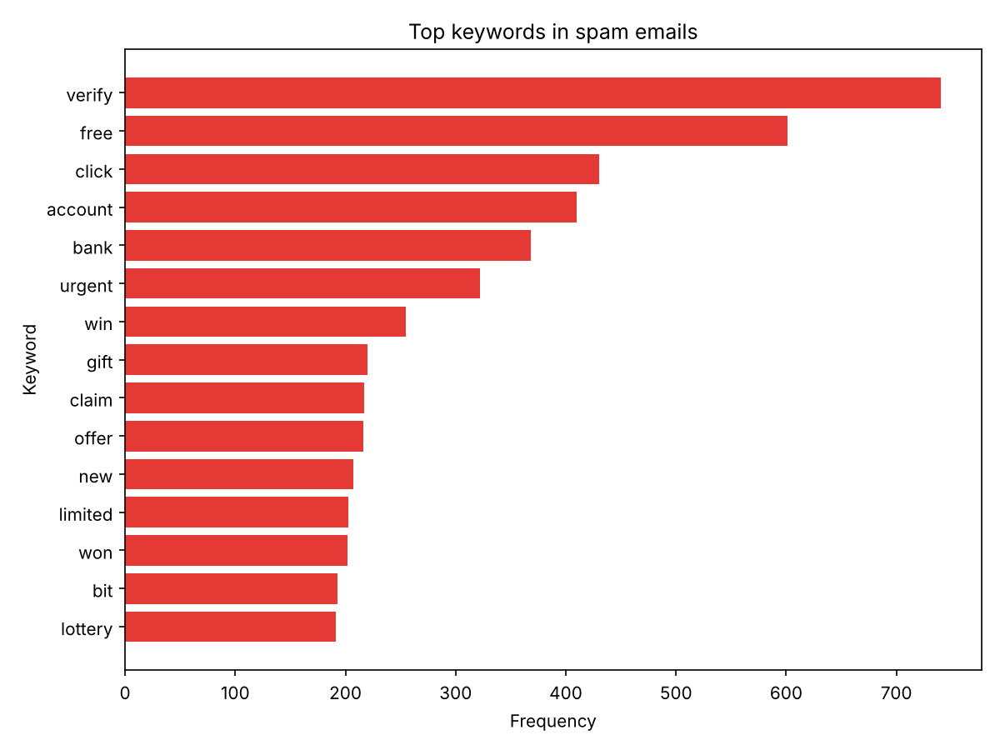
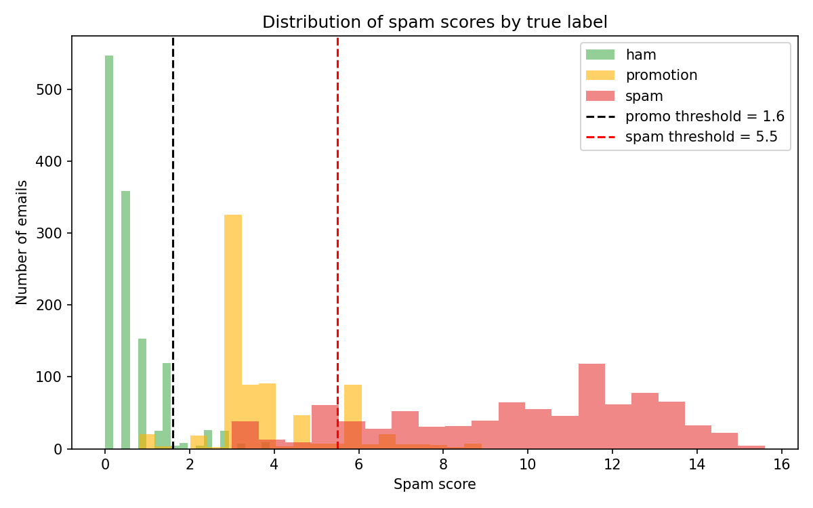
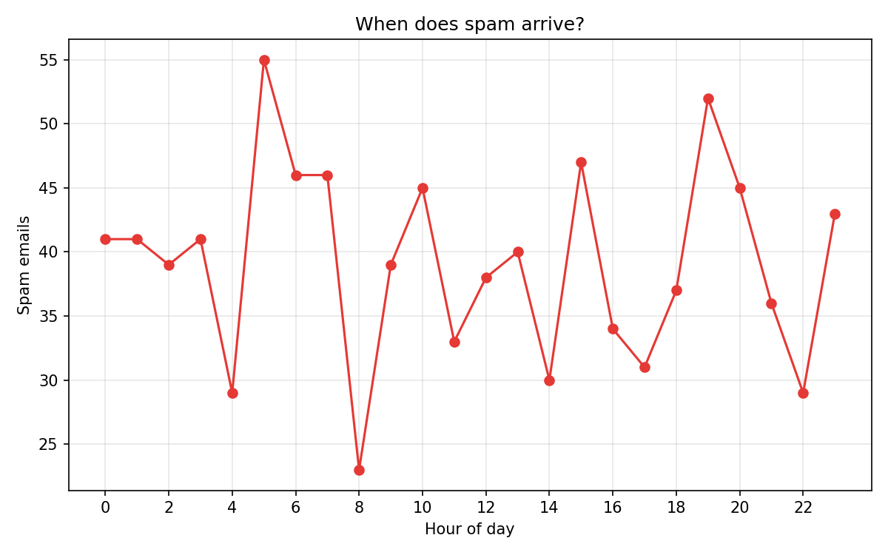
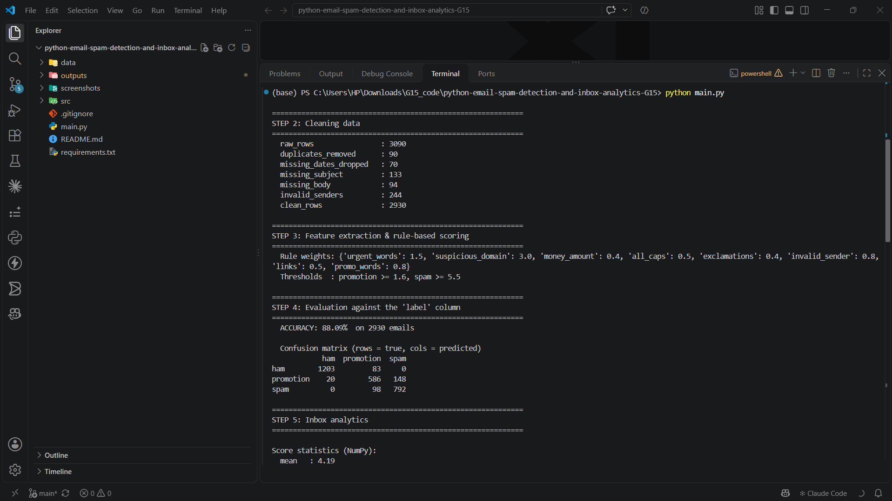
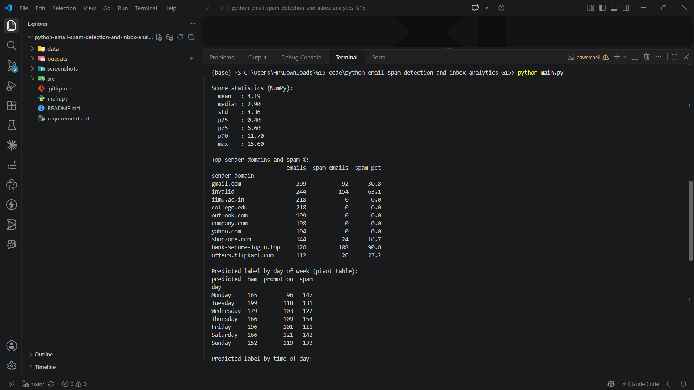
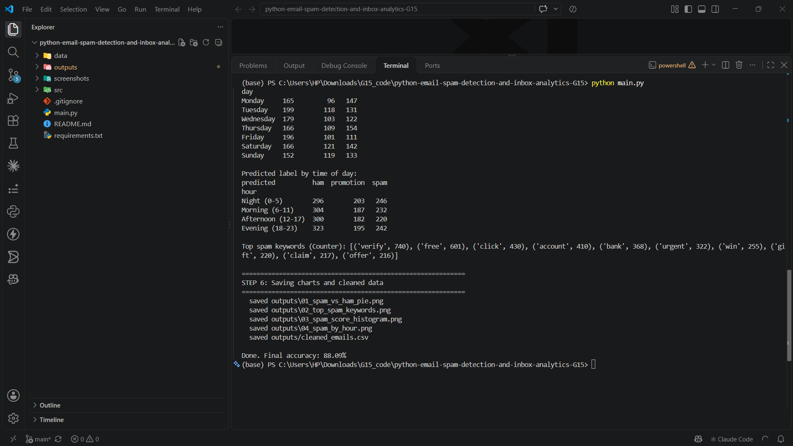

# Email Spam Detection & Inbox Analytics (Rule-Based)

**Python PG Group Project - Project P23 - Group G15**

**Members:**
FM1103: Eshan Metwate, FM1104

## Problem Statement
Email users lose time to spam and phishing messages. This project builds a **rule-based** spam
detector (no machine-learning library) that scores every email using text patterns, classifies it as
**Ham / Promotion / Spam**, measures accuracy against a label column, and reports inbox statistics.

## Dataset
`data/generate_data.py` creates `data/emails.csv` (about 3,000 synthetic emails, fixed random seed).

| Column | Meaning |
|---|---|
| sender | sender e-mail address |
| subject | subject line |
| body | e-mail text |
| date | date and time, written in mixed formats |
| label | ground truth: ham / promotion / spam |

Deliberate messiness: mixed dates (`2025-03-01`, `01/03/2025`, `1-Mar-25`), invalid senders
(`john@@gmail.com`, missing `@`), missing values, ~3% duplicate rows, extra whitespace, Rs and $
amounts, ALL-CAPS words and multiple `!!!`.

## How to Run
```bash
pip install -r requirements.txt
python main.py
```
`main.py` generates the data if missing, cleans it, extracts features, scores and classifies,
prints accuracy and analysis tables, and saves charts to `outputs/`.

## Project Structure
```
data/generate_data.py   synthetic dataset generator
src/cleaning.py         Pandas + regex cleaning, date parsing, sender validation
src/features.py         regex features, WEIGHTS dict, SpamScorer class, accuracy
src/analysis.py         groupby / pivot_table / Counter / NumPy statistics
src/visuals.py          Matplotlib charts
main.py                 runs everything end to end
```

## Approach
1. **Cleaning** - strip whitespace, drop duplicates, convert dates to one datetime format, flag invalid
   senders (kept, since an invalid sender is itself a spam signal), add `hour`, `day`, `sender_domain`.
2. **Regex patterns** - sender validation, URL extraction, money amounts (Rs / $), urgent phrases,
   ALL-CAPS words, promo words, date parsing.
3. **Features** - links, suspicious domain, money amounts, urgent words, all-caps words,
   exclamation marks, invalid sender, promo words.
4. **Scoring** - `score = features . weights` (NumPy dot product).
   `score >= 5.5` -> Spam, `1.6 <= score < 5.5` -> Promotion, else Ham.
5. **Evaluation** - accuracy and a hand-built confusion matrix.

Data structures: **list** (records), **tuple** (feature_name, value), **dict** (rule weights),
**set** (suspicious TLDs/domains, stop-words), **Counter** (keywords), **class** (`SpamScorer`).

## Results
Accuracy on the generated dataset: **88%** (see the terminal output / screenshots).

## Charts





## Screenshots




## Resume Bullet
Built a rule-based email spam detector in Python that extracts text features with regex and
classifies emails with 88% accuracy, visualising inbox patterns in Matplotlib.
